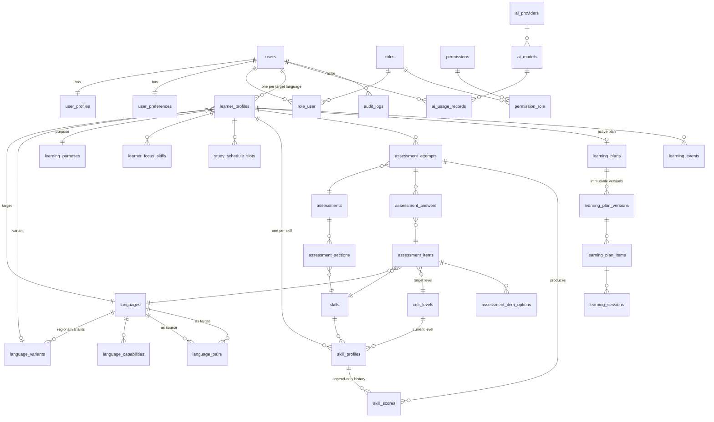

# 02 — Database Architecture & ERD

PostgreSQL 16. Conventions:
- `bigint` identity PKs internally; public-facing resources additionally expose a `ulid` (`public_id`) where IDs appear in URLs shared outside the owner's session (attempts, plans, conversations).
- `timestamptz` everywhere; `created_at/updated_at` on all mutable tables; `deleted_at` (soft delete) on user-owned and content tables.
- Small fixed vocabularies (skills, CEFR levels, purposes) are **lookup tables**, not PG enums, so admins can extend them without migrations.
- JSON columns (`jsonb`) only for immutable snapshots (plan rationale inputs, AI raw output, rubric breakdowns) or provider-specific config — **never** for mutable learning state.
- ✅ = implemented in Phase 1 migrations. Others are designed here and land in later phases.

## Core ERD (Phase 1 implemented)

## Table reference

### Identity ✅
| Table | Key columns | Constraints / indexes |
|---|---|---|
| `users` | id, name, email, password, email_verified_at, status(`active/suspended`), last_active_at, deleted_at | unique(email) |
| `user_profiles` | user_id, native_language_id, interface_language_id, timezone, country_code, birth_year | unique(user_id) |
| `user_preferences` | user_id, theme, daily_reminder_enabled, reminder_time, marketing_opt_in, data_processing_consent_at | unique(user_id) |
| `roles`, `permissions`, `role_user`, `permission_role` | slug-based RBAC (`student`, `content_editor`, `support`, `admin`, `super_admin`) | unique(slug); composite PKs |
| `personal_access_tokens`, `sessions`, `password_reset_tokens` | Laravel/Sanctum standard | |

### Languages ✅
| Table | Key columns | Notes |
|---|---|---|
| `languages` | code (BCP-47, e.g. `en`, `ar`), name, native_name, direction(`ltr/rtl`), script, is_active, is_target_enabled, is_interface_enabled, sort_order | unique(code) |
| `language_variants` | language_id, code (`en-GB`, `ar-EG`), name, is_default | unique(code) |
| `language_capabilities` | language_id, feature (`tts`,`stt`,`pronunciation`,`content_generation`,`realtime_voice`,`writing_evaluation`), status(`supported/beta/unsupported`), quality_tier(1–3), provider_slug, notes | unique(language_id, feature, provider_slug) |
| `language_pairs` | source_language_id, target_language_id, is_active, explanation_quality | unique(source,target) — governs "explain in native language" |

### Onboarding / learner ✅
| Table | Key columns | Notes |
|---|---|---|
| `learning_purposes` | slug, name, skill_weights (FK rows in `learning_purpose_skill_weights`) | lookup |
| `learning_purpose_skill_weights` | purpose_id, skill_id, weight numeric(4,2) | unique(purpose, skill) |
| `skills` | slug (`listening`,`speaking`,`reading`,`writing`,`grammar`,`vocabulary`), name, is_productive | lookup |
| `cefr_levels` | code (`PRE_A1…C2`), label, ordinal(0–6), description | unique(code), unique(ordinal) |
| `learner_profiles` | public_id, user_id, target_language_id, language_variant_id, learning_purpose_id, self_reported_level_id, target_level_id, daily_minutes, status(`onboarding/assessment_pending/active/paused/archived`), onboarded_at, deleted_at | **unique(user_id, target_language_id) where deleted_at is null**; index(user_id,status) |
| `learner_focus_skills` | learner_profile_id, skill_id | PK(profile, skill) |
| `study_schedule_slots` | learner_profile_id, day_of_week(0–6), preferred_time (`morning/afternoon/evening/HH:MM`) | unique(profile, day) |
| `learning_preferences` | learner_profile_id, preference_key, value | e.g. `prefers_audio`, `explanation_language` — key/value rows, not JSON |

### Assessment ✅
| Table | Key columns | Notes |
|---|---|---|
| `assessments` | slug, type(`placement/progress/exam`), name, version, is_active | unique(slug, version) |
| `assessment_sections` | assessment_id, skill_id, position, min_items, max_items, target_standard_error, time_limit_seconds | unique(assessment, skill) |
| `assessment_items` | public_id, language_id, skill_id, cefr_level_id, format(`mcq`,`cloze_mcq`,`true_false`,`listening_mcq`,`reading_mcq`,`ordering`), difficulty numeric(5,2) (Rasch logit), stimulus_text, audio_path, prompt, explanation, grammar_topic_slug, source(`authored/ai_generated`), review_status(`draft/in_review/published/retired`), exposure_count, deleted_at | index(language_id, skill_id, review_status, difficulty) |
| `assessment_item_options` | item_id, label, position, is_correct | ≥1 correct enforced by service + test |
| `assessment_attempts` | public_id, learner_profile_id, assessment_id, status(`in_progress/completed/abandoned`), started_at, completed_at, overall_level_id, overall_is_provisional, engine_version | index(profile, status) |
| `assessment_attempt_sections` | attempt_id, skill_id, status(`pending/in_progress/completed/skipped/not_available`), theta numeric, standard_error numeric, items_answered, estimated_level_id, skip_reason | unique(attempt, skill) — **per-skill state is rows, not JSON** |
| `assessment_answers` | attempt_id, item_id, selected_option_id, is_correct, response_time_ms, theta_after, se_after, answered_at | **unique(attempt_id, item_id)** → idempotent |
| `skill_profiles` | learner_profile_id, skill_id, cefr_level_id, theta, standard_error, confidence(`low/medium/high`), source(`placement/practice/self_report`), assessed_at | unique(profile, skill) — current state |
| `skill_scores` | skill_profile_id, assessment_attempt_id (nullable), theta, scaled_score(0–100), cefr_level_id, evidence_count, recorded_at | append-only history; index(skill_profile_id, recorded_at) |
| `assessment_reports` | attempt_id, summary, strengths, weaknesses, recommendations (rows in `assessment_report_findings`) | |
| `assessment_report_findings` | report_id, skill_id, type(`strength/weakness/recommendation`), code, detail, position | explainable, queryable |

### Learning plans ✅
| Table | Key columns | Notes |
|---|---|---|
| `learning_plans` | public_id, learner_profile_id, status(`active/paused/archived`), current_version_id, paused_at | unique(learner_profile_id) where status <> archived |
| `learning_plan_versions` | plan_id, version_number, generator(`rules_v1`, later `adaptive_v1`), trigger(`initial/assessment/user_regenerate/settings_change/adaptive`), daily_minutes, valid_from, inputs_snapshot jsonb (immutable), rationale text | unique(plan_id, version_number) |
| `learning_plan_version_allocations` | version_id, skill_id, priority_score, minutes_per_week, reason_code | why each skill got its time |
| `learning_plan_items` | public_id, version_id, scheduled_date, position, skill_id, activity_type, title, objective, target_level_id, estimated_minutes, reason_code, status(`pending/in_progress/completed/skipped`), completed_at | index(version_id, scheduled_date) |
| `learning_sessions` | public_id, learner_profile_id, plan_item_id (nullable), started_at, ended_at, active_seconds, outcome(`completed/abandoned`), self_rating | index(profile, started_at) |
| `learning_events` | learner_profile_id, user_id, event_type, subject_type, subject_id, skill_id, value numeric, occurred_at, metadata jsonb | append-only analytics; index(profile, occurred_at), index(event_type, occurred_at); partition by month at scale |

### AI (skeleton ✅, full in Phase 3)
| Table | Key columns |
|---|---|
| `ai_providers` | slug, name, driver, is_enabled, config jsonb (non-secret only; secrets in env/secret manager) |
| `ai_models` | provider_id, slug, operation(`text/tts/stt/realtime/embedding`), input_cost_per_mtok, output_cost_per_mtok, audio_cost_per_minute, is_default, is_enabled |
| `ai_prompts` / `ai_prompt_versions` | key, version, template, json_schema, status ✅ |
| `ai_usage_records` | user_id, learner_profile_id, model_id, operation, input_tokens, output_tokens, audio_seconds, cost_micros, latency_ms, status, error_code, created_at — index(user_id, created_at), index(model_id, created_at) |

### Audit ✅
`audit_logs`: actor_user_id, action, auditable_type, auditable_id, old_values jsonb, new_values jsonb, ip_address, user_agent, created_at. Append-only, index(auditable_type, auditable_id), index(actor_user_id, created_at).

## Later-phase tables (designed, not yet migrated)

**Phase 2 – Curriculum/Exercises/Vocabulary/Grammar** ✅ implemented (see [11-practice-and-srs.md](11-practice-and-srs.md)); as built: `translations`, `grammar_topics`, `grammar_topic_examples`, `grammar_mastery`, `vocabulary_words`, `vocabulary_forms`, `vocabulary_examples`, `vocabulary_relations`, `user_vocabulary`, `flashcard_reviews`, `vocabulary_collections`, `vocabulary_collection_items`, `learning_objectives`, `exercises`, `exercise_objectives`, `exercise_questions`, `exercise_options`, `exercise_accepted_answers`, `exercise_attempts`, `exercise_answers`, `courses`, `course_units`, `lessons`, `lesson_objectives`, `lesson_words`, `lesson_exercises`, `lesson_progress`, `user_progress`; plus `learning_plan_items.lesson_id/exercise_id/topic` and `learning_sessions.activity_type`. Original design notes:
`courses`(language_id, target_level range, status) → `course_levels` → `modules` → `lessons`(type, content blocks in `lesson_blocks` rows) → `learning_objectives`(+ `lesson_objectives` pivot).
`exercises`(language_id, cefr_level_id, skill_id, type, instructions, difficulty, estimated_seconds, review_status) → `exercise_questions` → `exercise_options`; `exercise_objectives` pivot; `exercise_attempts` → `exercise_answers`(is_correct, score, feedback).
`grammar_topics`(language_id, slug, cefr_level_id, parent_id) · `grammar_attempts` · `grammar_mastery`(profile, topic, mastery, last_practiced_at).
`vocabulary_words`(language_id, lemma, pos, cefr_level_id, frequency_rank, ipa, audio_path) · `vocabulary_senses` · `vocabulary_examples` · `user_vocabulary`(profile, word, collection_id, srs state: stability, difficulty, due_at, reps, lapses) · `flashcard_reviews`(append-only) · `vocabulary_collections`.
`user_progress`(profile, skill, date, minutes, items, accuracy) — daily rollup.

**Phase 3 – Speech/Tutor/Writing** ✅ implemented (see [12-tutor-and-adaptive.md](12-tutor-and-adaptive.md)); as built: `ai_tutors`, `conversation_scenarios`, `ai_conversations`, `ai_messages`, `ai_feedback`(source), `ai_conversation_reports`(+items), `audio_recordings`, `speech_transcriptions`, `pronunciation_results`, `pronunciation_word_results` (word-level, not phoneme), `production_tasks`, `writing_submissions`, `writing_evaluations`(+criteria, span-anchored corrections), `learner_mistake_patterns`. Original design notes:
`audio_recordings`(owner, disk, path, duration, mime, checksum, purpose) · `speech_transcriptions` · `pronunciation_results`(+ `pronunciation_phoneme_results`) · `ai_tutors`(persona, language_id nullable, voice, style) · `ai_conversations`(profile, tutor, scenario_id, difficulty, status) · `ai_messages` · `ai_feedback`(message/conversation, type, original, correction, explanation) · `conversation_scenarios` · `writing_submissions` · `writing_evaluations`(rubric rows in `writing_evaluation_criteria`).

**Phase 4 – Billing/Gamification/Admin** ✅ implemented (see [13-business-and-admin.md](13-business-and-admin.md)); as built: `subscription_plans`, `plan_entitlements`, `billing_customers`, `subscriptions` (user payer + optional `organization_id`), `payments`, `billing_events` (webhook idempotency), `usage_counters` (atomic quota counters), `notifications`, `organizations`, `organization_members`, `organization_invitations` (hashed tokens), `xp_ledger` (unique `dedupe_key`), `streaks`, `streak_days`, `achievements` (+translations), `user_achievements`, `challenges`, `challenge_progress`, `content_reviews`; `user_preferences.leaderboard_opt_in/alias`; `writing_evaluations` human-review columns. Original design notes:
`subscription_plans`(slug, interval, price_minor, currency, stripe_price_id) · `plan_entitlements`(plan, feature, limit, period) · `subscriptions`(user_id or organization_id, plan, status, provider ids, current_period_end, cancel_at) · `payments` · `usage_records`(subscription, feature, quantity, period_start) · `organizations` · `organization_members` · `achievements` · `user_achievements` · `xp_ledger` · `streaks` · `challenges` · `challenge_participants` · `leaderboard_snapshots` · `content_reviews` · `moderation_flags`.

**Phase 5 – Exams**
`exam_frameworks` (IELTS, TOEFL, …) · `exam_sections` · `exam_forms` · `exam_attempts` · `exam_section_scores` · `score_conversions` (labelled *estimate*).
